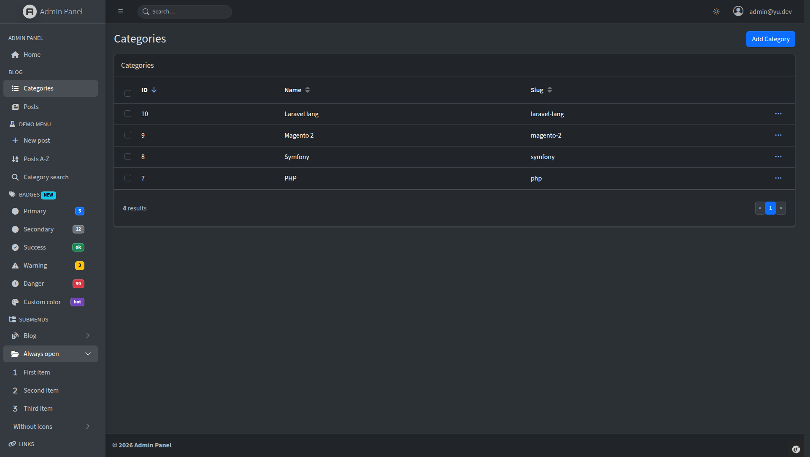
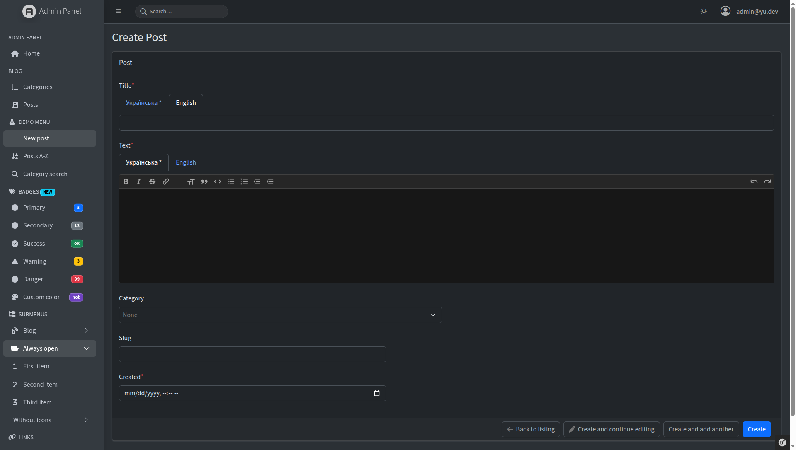

# EasyAdminLTE: AdminLTE theme for Symfony EasyAdmin

[](https://symfony.com)
[](https://github.com/EasyCorp/EasyAdminBundle)
[](https://adminlte.io)
[](https://www.php.net)
[](#license)

**EasyAdmin with your favorite AdminLTE theme.** A Symfony bundle that turns the
[EasyAdmin](https://github.com/EasyCorp/EasyAdminBundle) admin panel into [AdminLTE](https://adminlte.io).

The same CRUD controllers, fields, filters and actions of [EasyAdmin](https://github.com/EasyCorp/EasyAdminBundle),
the admin generator for [Symfony](https://symfony.com) applications, dressed in the familiar look of [AdminLTE 4](https://adminlte.io): dark sidebar, cards, small boxes,
light and dark color schemes. Install it and your admin looks like AdminLTE, with no PHP changes.





## The real AdminLTE, not a look-alike

- **Original AdminLTE 4.10.1.** `adminlte.min.css` and `adminlte.min.js` ship unmodified, so upgrading
  AdminLTE means replacing two files.
- **AdminLTE markup.** The layout, menu, login page, paginator and detail page are overridden to render
  the same HTML structure as the AdminLTE demo (`app-wrapper`, `app-sidebar`, `card`, `nav-treeview`...),
  so AdminLTE's classes just work.
- **Plays nicely with EasyAdmin.** AdminLTE is imported into the `@layer adminlte` CSS cascade layer,
  declared after EasyAdmin's layers. A small `easyadminlte.css` neutralizes the EasyAdmin styles that
  still leak in (button gradients, fixed field heights, datagrid column widths...).
- **No CDN.** Bootstrap Icons and the Source Sans 3 font (with Cyrillic) are bundled.

## Features

- AdminLTE sidebar built from the EasyAdmin menu: sections, submenus (treeview), badges, icons.
- Header with search, user menu and a light/dark switch (backed by EasyAdmin's own color scheme setting).
- Index pages as edge-to-edge tables inside a card, with the paginator in the `card-footer`.
- New/edit forms with the form actions in the card footer.
- Detail pages as bordered tables.
- AdminLTE-style login page.
- [Symfony UX Twig Components](https://symfony.com/bundles/ux-twig-component/current/index.html) for dashboards: `SmallBox`, `InfoBox`, `Card`.

## Requirements

- PHP 8.2+
- Symfony 6.4+ (developed on Symfony 8.1)
- EasyAdmin 5.6+ (it brings Symfony UX Twig Component and Asset along)

## Installation

In your Symfony application:

```bash
composer require yu-symfony/easyadminlte-bundle
```

If Symfony Flex didn't register the bundle, add it to `config/bundles.php`:

```php
return [
    // ...
    Yu\EasyAdminLTEBundle\EasyAdminLTEBundle::class => ['all' => true],
];
```

Publish the assets:

```bash
php bin/console assets:install --symlink --relative
```

Done: open `/admin`.

## Configuration

The theme is enabled by default. To switch back to the stock EasyAdmin look:

```yaml
# config/packages/easyadminlte.yaml
easyadminlte:
    enabled: false
```

When disabled, the theme templates and assets are not loaded; the Twig components stay available.

## Dashboard components

```twig
<div class="row">
    <div class="col-lg-3 col-6">
        <twig:AdminLTE:SmallBox value="150" text="New orders" icon="bi bi-cart"
            variant="primary" url="{{ path('admin_order_index') }}" />
    </div>
    <div class="col-lg-3 col-6">
        <twig:AdminLTE:InfoBox text="CPU" number="10" unit="%" icon="bi bi-gear-fill"
            variant="info" progress="10" description="Load over the last hour" />
    </div>
</div>

<twig:AdminLTE:Card title="Latest posts" variant="primary" outline collapsible maximizable>
    ...card body...
    <twig:block name="footer">
        <a href="{{ path('admin_post_index') }}">All posts</a>
    </twig:block>
</twig:AdminLTE:Card>
```

| Component  | Properties |
|------------|------------|
| `SmallBox` | `value`, `text`, `icon`, `variant`, `url`, `linkLabel` |
| `InfoBox`  | `text`, `number`, `unit`, `icon`, `variant`, `filled`, `progress` (0–100), `description` |
| `Card`     | `title`, `variant`, `outline`, `collapsible`, `collapsed`, `maximizable`, `removable`, `bodyClass`; blocks `tools`, `footer` |

`variant` accepts `primary`, `secondary`, `success`, `danger`, `warning`, `info`, `light` or `dark`.
The card collapse, maximize and remove buttons are handled by AdminLTE's JavaScript.

## Customizing

Templates are resolved in this order:

1. your application's `templates/bundles/EasyAdminBundle/`;
2. this bundle's templates;
3. EasyAdmin's original templates.

So any template can be overridden the usual Symfony way
([overriding bundle templates](https://symfony.com/doc/current/bundles/override.html#templates)). `layout.html.twig` adds a few blocks:

| Block                   | Purpose |
|-------------------------|---------|
| `adminlte_body_class`   | AdminLTE `<body>` classes (`layout-fixed sidebar-expand-lg`...) |
| `sidebar_brand_image`   | sidebar logo |
| `main_card_header`      | header of the page's main card |
| `app_footer`, `app_footer_start`, `app_footer_end` | page footer |

EasyAdmin's own blocks (`main_menu`, `content_title`, `page_actions`...) keep their names.

## Author

Yuriy Akishin:
- 📧 Email: yuriy.akishin@gmail.com
- 💼 LinkedIn: https://www.linkedin.com/in/yuriyakishin/
- 💻 GitHub: https://github.com/yuriyakishin

## License

MIT. Third-party files in `public/`: AdminLTE (MIT, license in the `adminlte.min.css` header),
Bootstrap Icons (MIT) and Source Sans 3 (SIL OFL 1.1); the licenses of the last two sit next to their files.
